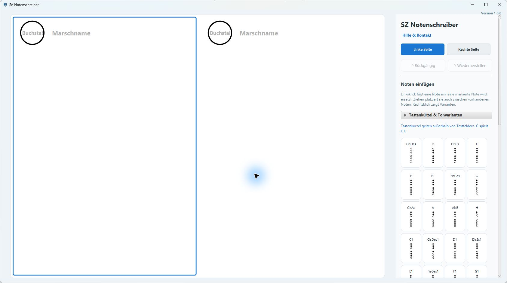

# 🎵 SZ-Notenschreiber

## Video

https://github.com/user-attachments/assets/9d980379-5ff9-4c12-b3c6-ab471a30ced9

**NotesWriter** ist eine JavaFX-Anwendung zur grafischen Darstellung und Verwaltung von Ces-Querflöten-Grifftabellen.  
Das Programm erlaubt das Zeichnen, Speichern, Laden und Drucken von Notenseiten mit Griffbildern.  

---

## Notenmikrofon

Im Bereich **Noten einfügen → Notenmikrofon** das Mikrofon und
das Instrument wählen, danach **Mikrofon starten** drücken.
Voreingestellt ist **Ces-Querflöte (Halbton tiefer)**: Zur gehörten Tonhöhe wird
ein Halbton addiert, um den notierten Ton zu erhalten. Zusätzlich stehen C-Querflöte,
C-Piccolo und die höher klingende Ces-Sopranflöte zur Auswahl. Letztere wird
um elf Halbtöne nach unten auf die notierte Tonhöhe umgesetzt.

Die separate **Grifflage (Oktaven)** passt diesen Ton an die Register der
Grifftabelle an. Für die hier verwendete Ces-Flöte ist sie anhand des gemeldeten
Messungen auf **−1** voreingestellt: ca. 550 Hz ergibt D mit Oktav-X,
ca. 1124 Hz normales D und ca. 2207 Hz das hohe D1. Die Oktav-Markierung
bezeichnet in dieser Grifftabelle die tiefere Lage. Das ist eine Anpassung an diese
Flöte und keine allgemeine Eigenschaft aller Ces-Flöten. Bei einer anderen
Flöte kann die Grifflage vor dem Start zwischen −2 und +2 geändert werden.
Ein Instrumentwechsel setzt sie auf −1 für Ces-Querflöte, sonst auf 0 zurück.
Die Anzeige „Grifflage“ bezeichnet die interne Zuordnung, nicht die klingende Oktave.

Einen einzelnen Ton etwa 0,3 Sekunden halten: Das erkannte Griffbild wird auf
der aktiven Seite eingefügt. Ein gehaltener Ton wird nur einmal übernommen;
für denselben Ton erneut etwa 0,2 Sekunden pausieren. Stabile Tonwechsel können
auch ohne Pause übernommen werden. **Mikrofon stoppen** beendet die Aufnahme.
Während das Mikrofon aktiv ist, zeigt ein roter Hinweis oben mittig auf der Seite
„Mikrofon ist an“. Dieser Hinweis ist nur im Editor sichtbar und wird nicht gedruckt.

Es werden keine Referenz-Tondateien benötigt, keine Aufnahmen gespeichert und
keine Audiodaten hochgeladen. Die Tonhöhe wird lokal aus dem Mikrofonsignal
berechnet. Notenlängen, Pausen und alternative Griffe werden weiterhin manuell
bearbeitet. Begleitmusik oder mehrere Instrumente gleichzeitig sind nicht vorgesehen.

Der Kammerton ist auf A = 440 Hz eingestellt und kann vor dem Start zwischen
430 und 450 Hz geändert werden. Bei Störgeräuschen den Empfindlichkeitsregler
nach rechts bewegen; bei leisen, nicht erkannten Tönen nach links. Einstellungen
können bei gestopptem Mikrofon geändert werden. Ist kein Zugriff möglich, in den
Windows-Datenschutzeinstellungen den Mikrofonzugriff für Desktop-Apps erlauben
und das gewählte Eingabegerät prüfen.

Nach Instrument- und Grifflagenkorrektur gilt intern: Die gemessenen
Ces-Referenzen für F_Oktav, Fis/Ges_Oktav, G_Oktav, F, Fis/Ges, F1 und G1 liegen bei
ca. 670, 718, 736, 1350, 1400, 2888 und 2972 Hz. Die Grenze zwischen
Fis/Ges_Oktav und G_Oktav liegt bei 727 Hz. Die übrigen Noten verwenden
weiterhin die MIDI-Zuordnung.
Bei Piccolo wird der gehörte Ton zuvor um eine Oktave nach unten versetzt.
Außerhalb dieses Bereichs wird keine Note eingefügt; insbesondere fehlt im
bisherigen Griffmodell ein tiefes C4. Die Alternative F_1 wird nicht automatisch
gewählt, da sich verschiedene Griffe derselben Tonhöhe akustisch nicht unterscheiden lassen.

---

## 🚀 Funktionen

- Griffbilder für verschiedene Töne und Oktavvarianten anzeigen.
- Zwei getrennte Notenseiten bearbeiten.
- Noten speichern, laden, drucken und als PDF ausgeben.
- Noten, Pausen, Wiederholungszeichen und Leerblöcke per Drag-and-Drop verschieben.
- Mehrere Elemente mit einem Auswahlrahmen markieren und gemeinsam verschieben.
- Bögen über eine Notenauswahl einfügen, verschieben und löschen.
- Freitext einfügen, Schriftgröße ändern und Elemente löschen.
- Bearbeitungsschritte rückgängig machen und wiederherstellen.
- Optional gespielte Töne über das Notenmikrofon erkennen.

---

## 🛠️ Voraussetzungen

- JDK **22**
- JavaFX 22.0.1 (über Maven)
- Maven oder IntelliJ IDEA

---

## ▶️ Starten
### **1. Repository klonen**
```bash
git clone https://github.com/Schlieri97/NotesWriter.git
cd NotesWriter
```

### **2. Starten mit Maven**
```bash
mvn clean javafx:run
```

Oder in **IntelliJ IDEA**:
1. Öffne das Projektverzeichnis.
2. Stelle sicher, dass „JavaFX“ korrekt eingebunden ist.
3. Starte die `Main`-Klasse.
   
### **3. Desktop-Builds über GitHub Actions**

Der Workflow `.github/workflows/build.yml` baut die Windows-App. Für macOS
startest du `.github/workflows/build-macos.yml` unter **Actions → Mac-App bauen
→ Run workflow**. Beide Workflows stellen die fertigen Pakete als GitHub-
Artifacts zum Download bereit.

---

## 📂 Projektstruktur

```
NotesWriter/
 ├── .github/workflows/       # Windows- und macOS-Builds
 ├── docs/                    # macOS-Hinweise und Screenshot
 ├── scripts/                 # macOS-Buildskript
 ├── src/main/java/           # JavaFX-Anwendung
 ├── src/main/resources/      # FXML-Oberfläche, Griffbilder und Logo
 ├── src/main/test/            # bestehende zusätzliche Testquelle
 ├── src/test/java/            # Maven-/JUnit-Tests
 ├── pom.xml
 ├── mvnw, mvnw.cmd
 └── README.md
```

---

## 💾 Dateiformat

Beim Speichern entsteht eine frei benennbare Textdatei. Jede Zeile besteht aus
einem Seitenbezeichner und einem semikolongetrennten Inhalt. Noten werden als
`TON|VARIANTE` gespeichert; mögliche Varianten sind `NORMAL`, `OKTAV`, `LANG`,
`KURZ`, `FESTE`, `OKTAV_LANG` und `OKTAV_KURZ`.

```
Kreis1;<Base64-Text>
Kreis1Groesse;18
Seite1;D|NORMAL
Seite1;F|OKTAV
Seite1;PAUSENSTRICH
Seite1;WIEDERHOLUNG|ANFANG
Seite1;LEERBLOCK|SIZE|20
Seite1;PAUSE_FREI|120.0|80.0
Seite1;TEXT|<Base64-Text>|160.0|90.0|18
Seite1;BOGEN|2,1;3,1;4,1
```

Gespeichert werden außerdem die vier Seitentexte (`Kreis1`, `Marsch1`,
`Kreis2`, `Marsch2`) und ihre Schriftgrößen. Ein Standard-Leerblock wird als
`LEERBLOCK` geschrieben; die Größenangabe ist optional. Alte Dateien mit
`LEERBLOCK|<Zahl>` bleiben lesbar. Beim Laden kann eine Datei überschrieben
oder zu den vorhandenen Inhalten hinzugefügt werden.

---

## 🧠 Hinweise zur Bedienung

- Klick auf Note → fügt Notenbild in die aktuelle Seite ein
- Note per Drag-and-Drop auf eine Seite ziehen → an der Zeigerposition einfügen, auch zwischen vorhandenen Noten
- **Wiederholungszeichen verschieben** → alle fünf Varianten direkt am Zeichen oder Querstrich greifen und an die gewünschte Position in der Notenfolge ziehen. Sie rasten am Notenraster ein, auch auf der anderen Seite. Vorheriges Markieren ist nicht nötig; mehrere markierte Zeichen können gemeinsam verschoben werden.
- „Tastenkürzel & Tonvarianten“ → Details bei Bedarf aufklappen
- **„Linke Seite“ / „Rechte Seite“** → wählt die gewünschte Notenseite aus
- **„Pausenstrich“** → fügt einen waagerechten Pausenstrich ein
- **Bogen** → mindestens zwei Noten markieren, rechtsklicken und „Bogen über Auswahl“ wählen; ein vorhandener Bogen lässt sich per Rechtsklick löschen
- **Pausenstrich frei platzieren** → Pausenstrich rechtsklicken, die freie Platzierung wählen und anschließend beliebig auf der Seite positionieren
- **↶ Rückgängig / ↷ Wiederherstellen** → Bearbeitungsschritte zurücknehmen oder erneut ausführen; auch mit **Strg+Z** und **Strg+Umschalt+Z**
- **„Leerer Notenblock“ / Enter** → fügt standardmäßig einen freien Block mit 41 Notenplätzen ein; der freie Block ist im Editor beschriftet, die Beschriftung erscheint nicht im Druck/PDF
- **Leerblock anpassen** → direkt am Block mit **− / +** jeweils einen Notenplatz entfernen oder hinzufügen; per Rechtsklick stehen Schnellgrößen (1, 10, 20, 30, 41) und eine freie Eingabe bereit. Wenn die Größe nicht mehr in die aktuelle Zeile passt, beginnt der Block geschlossen in der nächsten Zeile. Ziehen an der linken oder rechten Kante bleibt für die Feinsteuerung möglich; in der Mitte ziehen verschiebt den Block und rastet am Notenraster ein
- **Leeren Notenblock löschen** → Beschriftung anklicken und Backspace / Entf drücken; mehrere Leerblöcke lassen sich mit einem Auswahlrahmen markieren und gemeinsam löschen
- **Freitext** → nach dem Einfügen per Rechtsklick die Schriftgröße wählen oder eine eigene Größe zwischen 8 und 72 pt eingeben
- **Backspace / Entf** → löscht die letzte Eingabe der aktiven Seite; ein zuletzt eingefügter Leerblock wird als Ganzes entfernt
- **„Drucken / PDF exportieren“** → wahlweise mit Cis/Des auffüllen oder Leerstellen beibehalten; für PDF einen PDF-Drucker auswählen

### Tastatur

Tastenkürzel gelten außerhalb von Textfeldern und hängen neue Noten an die aktive Seite an.
Ein gehaltener Ton wird nicht wiederholt eingefügt. Die Tasten stehen auch in den Tooltips der Notenbuttons.

| Taste | Ton |
| --- | --- |
| C, D, E, F, G, A, H | C1, D, E, F, G, A, H |
| S, R, T, Z, B | Cis/Des, Dis/Es, Fis/Ges, Gis/As, Ais/B |
| V | Alternativer F-Griff (F_1) |
| 1, 2, 3, 4, 5 | C1, Cis/Des1, D1, Dis/Es1, E1 |
| 6, 7, 8, 9, 0 | F1, Fis/Ges1, G1, Gis/As1, A1 |

| Kombination mit Tontaste | Variante |
| --- | --- |
| Strg | Lang |
| Alt | Kurz |
| Umschalt | Oktav |
| Strg + Umschalt | Oktav lang |
| Alt + Umschalt | Oktav kurz |
| Strg + Alt | Feste |

Beispiel: **D** schreibt D, **Strg+D** ein langes D und **Alt+Umschalt+D** ein kurzes Oktav-D.
Nicht verfügbare Oktav-Varianten werden mit einem Hinweis abgewiesen.

---

## 🖼️ Screenshot



---

## 👨‍💻 Autor

**Schlieri97**  
📧 [GitHub-Profil](https://github.com/Schlieri97)

---

## English version

# 🎵 SZ-Notenschreiber

SZ-Notenschreiber is a JavaFX application for creating, editing, saving and printing fingering-chart pages for the Ces transverse flute. Notes, rests, repeat signs, slurs, empty blocks and text can be placed directly on the page.

## Features

- Fingering charts for notes and octave variants
- Two editable music pages
- Drag and drop for notes, rests, repeat signs and empty blocks
- Rectangle selection for moving multiple elements
- Save, load, undo, redo, print and PDF export
- Optional microphone input for recognizing played notes

## Requirements

- JDK 22
- Maven or the Maven Wrapper
- JavaFX 22.0.1

## Run

```bash
git clone https://github.com/Schlieri97/NotesWriter.git
cd NotesWriter
mvn clean javafx:run
```

You can also open the project in IntelliJ IDEA and run `com.code.noteswriter.Main`.

## Build desktop packages

Run **Actions → Build desktop apps** for Windows or **Actions → Mac-App bauen** for macOS. The packages include their own Java runtime, so Java is not required on the target computer. macOS provides separate DMG artifacts for Apple Silicon and Intel Macs.

## Usage

Click or drag notes onto the page, drag elements to move them, or draw a selection rectangle for multiple elements. Repeat signs snap to the note grid. Backspace/Delete removes the selection, Escape clears selections, and Ctrl+Z / Ctrl+Shift+Z undo and redo.

## File format

Saved documents are user-named plain-text files. Each line contains a page key
and a semicolon-separated value. Notes use `NOTE|VARIANT`-style tokens such as
`D|NORMAL` or `F|OKTAV`; page headings,
repeat signs, rests, empty blocks, free text and slurs are stored as well. For
example:

```text
Kreis1;<Base64 text>
Kreis1Groesse;18
Seite1;D|NORMAL
Seite1;F|OKTAV
Seite1;PAUSENSTRICH
Seite1;WIEDERHOLUNG|ANFANG
Seite1;LEERBLOCK|SIZE|20
Seite1;PAUSE_FREI|120.0|80.0
Seite1;TEXT|<Base64 text>|160.0|90.0|18
Seite1;BOGEN|2,1;3,1;4,1
```

## Author

**Schlieri97** — [GitHub profile](https://github.com/Schlieri97)
